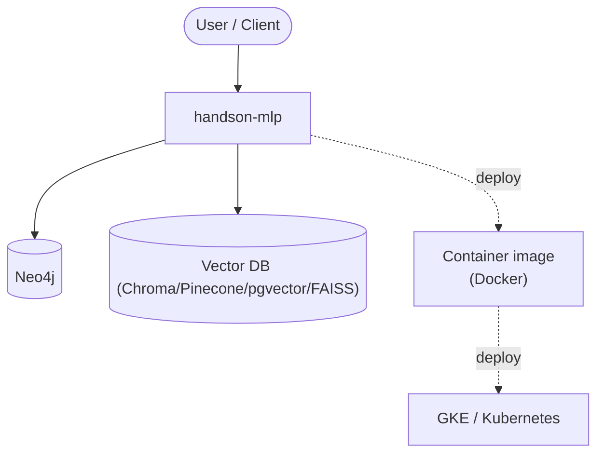

# Context Map — `handson-mlp`

> Auto-generated architecture & deployment context map. Summarizes the core application, container/cloud footprint, and database connections. Regenerate after significant structural changes.

**Repo:** `avnit/handson-mlp` · **Fork** · Public · Primary language: Jupyter Notebook · Default branch: `main` · Files: 49

**Description:** A series of Jupyter notebooks that walk you through the fundamentals of Machine Learning and Deep Learning in Python using Scikit-Learn, PyTorch, and Hugging Face libraries.

## 1. Core application

Hands-On Machine Learning with Scikit-Learn and PyTorch

- **Frameworks / runtime:** Jupyter notebooks
- **Listens on port(s):** 8888, 1945, 1963, 6006

## 2. Containers & cloud applications

**Containers:**
- `.dockerignore`
- `docker/Dockerfile`

**Detected cloud platforms / services:** GKE / Kubernetes

## 3. Database connections

**Datastores in use:** Neo4j, Vector DB (Chroma/Pinecone/pgvector/FAISS)

**Referenced in:**
- `08_unsupervised_learning.ipynb`

## 4. Architecture diagram

## 5. Security posture

- **Static scan findings:** 1 high

| Severity | Rule | File:Line |
|---|---|---|
| high | curl-pipe-shell | `docker/Dockerfile:20` |

---
_Generated by repo context-mapping pass on 2026-08-13._